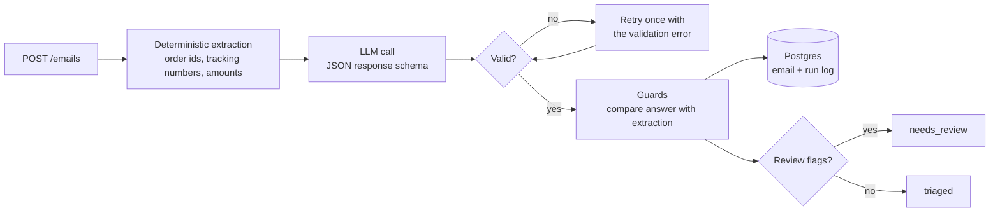

# ClaimDesk


An LLM-powered triage service for delivery-dispute emails, built for an after-sales team.
Every incoming email is classified, its identifiers are extracted and checked against the
text, every model call is logged with its cost, and anything uncertain goes to a person.

> **Status: step 1 of 5.** Triage pipeline, API, run log and CI are done.
> The agent with tools, human approval, evals and the dashboard are next (see [Roadmap](#roadmap)).

## Why this project

In a previous job at a retail group, I built a workflow that classified carrier-dispute
emails for the logistics team and fed a dashboard of the carriers causing the most disputes.
ClaimDesk rebuilds that idea in public, with what production use taught me to care about:
answers validated in code rather than trusted, identifiers that cannot be invented, a log of
every run, and (next) evaluations that block a regression before it ships.

All data in this repository is fictional: the retailer (Maison Lumen), the carriers, the
customers and the orders.

## How it works (step 1)



1. **Extraction first.** Regexes find order ids (`ML-104201`, also written `ml104201`),
   tracking numbers and amounts before any model call.
2. **One structured call.** The model gets the email inside delimiters, the extracted values
   as hints, and must answer in a JSON schema (category, urgency, requested action, ids,
   summary, confidence).
3. **Validation in code.** The answer is parsed with Pydantic. If it is invalid, the model
   gets one retry with the exact validation error.
4. **Guards.** An order id or tracking number that does not appear in the email is dropped
   and flagged. Several order ids, a claim without any identifier, low confidence or high
   urgency send the email to review. The model never decides on its own that no human is needed.
5. **Run log.** Each run stores the model, prompt version, attempts, tokens, latency,
   estimated cost, flags, and the raw output when it fails.

## Design decisions

The short version is below; the reasoning is in [docs/decisions.md](docs/decisions.md).

| Decision | Why |
|---|---|
| Deterministic extraction before the LLM | A regex cannot invent an order id. Its output is also the reference used to check the model. |
| The code decides `needs_review`, not the model | Review rules can be tested without any LLM and do not change when the prompt changes. |
| Small `LLMClient` interface | The triage logic never imports a provider SDK. Gemini today, another model by adding one class. |
| A fake LLM client for tests | The test suite runs in CI on every push, for free, and is deterministic. |
| Prompt untrusted, delimiters sanitised | An email cannot close the `<email>` block and add instructions outside it. |
| Postgres + JSONB, migrations with Alembic | One database for orders, emails and run logs; CI checks that migrations match the models. |

## Roadmap

- [x] **Step 1: triage pipeline.** Extraction, structured LLM call, validation and retry,
  guards, run log with cost, REST API, tests, CI with Postgres.
- [ ] **Step 2: agent and human approval.** Event-triggered queue and worker, an agent that
  calls tools (order lookup, carrier tracking, similar past cases with pgvector) exposed
  through an MCP server, and actions (refund, reply) that the agent can only *propose*:
  a person approves them before they run.
- [ ] **Step 3: evaluations.** Golden dataset, deterministic checks first, LLM-as-judge with a
  written rubric for free text, pass rate over repeated runs, prompt-injection cases, and a
  CI gate that fails on regression. Tracing with Langfuse.
- [ ] **Step 4: dashboard.** React interface: inbox, run details, approval queue, metrics.
- [ ] **Step 5: deployment.** Hosted demo with a public URL.

## Quick start

Requirements: Docker, and a free Gemini API key from [Google AI Studio](https://aistudio.google.com/apikey).

```bash
cp .env.example .env          # then put your GEMINI_API_KEY in .env
docker compose up --build     # Postgres + API on http://localhost:8000
```

Then open http://localhost:8000/docs, or send an email:

```bash
curl -X POST localhost:8000/emails -H "Content-Type: application/json" -d '{
  "sender": "camille.roux@example.com",
  "subject": "Vase cassé",
  "body": "Bonjour, ma commande ML-104201 est arrivée cassée. Pouvez-vous en renvoyer un ?"
}'
```

### Local development

```bash
cd backend
python -m venv .venv && source .venv/bin/activate
pip install -e ".[dev]"
docker compose up -d db       # from the repo root, or use your own Postgres
alembic upgrade head
python -m scripts.seed
uvicorn app.main:app --reload
```

Checks (the same as CI):

```bash
ruff check . && ruff format --check . && mypy app scripts tests && pytest
```

Run the 24 sample emails through the real model and compare with the expected labels:

```bash
python -m scripts.try_samples
```

## API

| Method | Path | Description |
|---|---|---|
| `POST` | `/emails` | Store an email and triage it. Returns the result and the run log. |
| `GET` | `/emails?status=needs_review` | List emails, optionally filtered by status. |
| `GET` | `/emails/{id}` | One email with all its runs. |
| `GET` | `/health` | Liveness check. |

## Project layout

```
backend/
  app/
    api/         FastAPI routes and dependencies
    llm/         LLMClient interface, Gemini client, fake client for tests
    triage/      extraction, prompt, classifier and guards, pipeline
    models.py    SQLAlchemy tables: orders, emails, triage_runs
    schemas.py   Pydantic models, including the LLM response schema
  alembic/       database migrations
  scripts/       seed data, sample run
  tests/         unit, API and Postgres integration tests
data/
  seed/          fictional orders
  samples/       24 fictional emails with expected labels
docs/            design decisions
```

## Tech stack

Python 3.12, FastAPI, Pydantic, SQLAlchemy 2, Alembic, PostgreSQL (pgvector image),
Google Gemini (`google-genai`), pytest, ruff, mypy, Docker, GitHub Actions.

Built with AI-assisted development (Claude Code).
